# CourtHub

A responsive web application for booking sports courts.

## Student Information

- STUDENT NAME: JOHN PAUL C. DE JESUS
- SECTION / BLOCK:  INF242
- SUBJECT: IPT
- WEBSITE CATEGORY Booking / Reservation

## Project Description

CourtHub is a court reservation website for basketball, volleyball, badminton, and pickleball. Users can browse the courts, book a time slot, and manage their bookings. It runs fully in the browser with no database; data is stored with LocalStorage and a JSON file.

## Main Features

- 5 pages: Home, Courts, Book Now, My Bookings, Contact
- Search and filter courts by sport (data loaded from a JSON file)
- Booking form with validation: required fields, no past dates, bookings only up to 14 days ahead, only within opening hours (5:00 AM to 11:00 PM), valid PH phone number (11 digits starting with 09)
- Double-booking prevention: a court cannot be booked if the time overlaps an existing booking
- Automatic total price based on the sport's hourly rate and the number of hours
- My Bookings page where bookings are saved and can be cancelled
- Contact form with validation (name, email, message)
- Responsive design for mobile and desktop

## Technologies Used

- HTML5
- CSS3
- JavaScript (vanilla)
- JSON
- LocalStorage
- Git and GitHub
- VS Code with Live Server

## Folder Structure

```text
courthub/
├── index.html
├── courts.html
├── book.html
├── my-bookings.html
├── contact.html
├── css/style.css
├── js/ (config.js, storage.js, booking.js, ui.js)
├── data/courts.json
├── images/
└── README.md
```

## How to Run It

1. Open the project folder in VS Code.
2. Install the **Live Server** extension by Ritwick Dey from the VS Code Extensions marketplace if you do not have it yet.
3. In the file explorer, right-click `index.html` and click **Open with Live Server**.
4. The project will open in your default browser at `http://127.0.0.1:5500/index.html`.

> **Note:** Simply double-clicking `index.html` from your file explorer will open it via the `file://` protocol. Modern browsers block JavaScript `fetch()` requests on local files due to CORS security policies, so double-clicking the file won't load the court list from the JSON file. A local server like Live Server is required.

## Screenshots

### Home
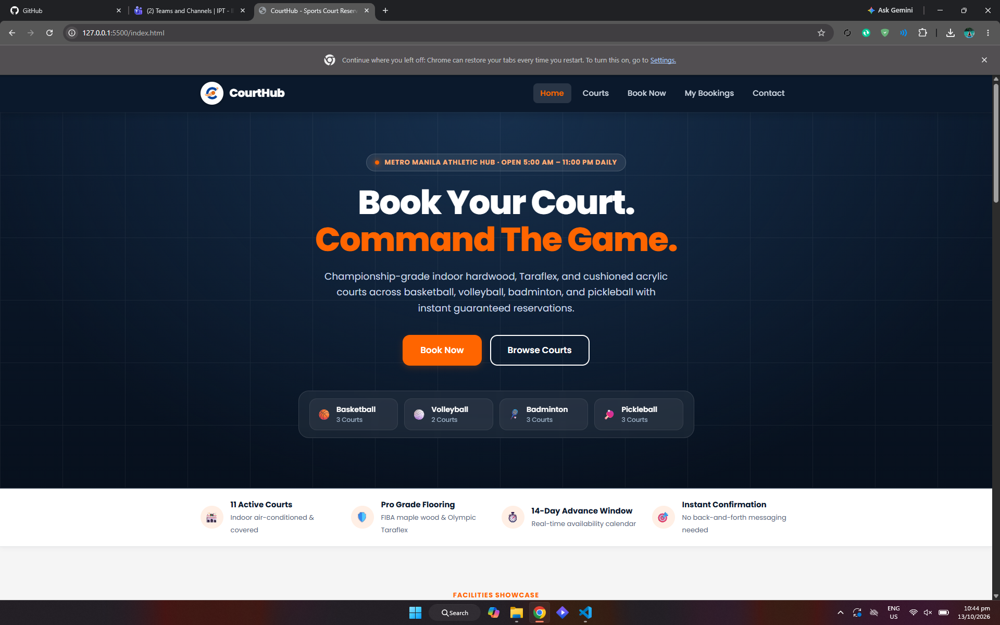
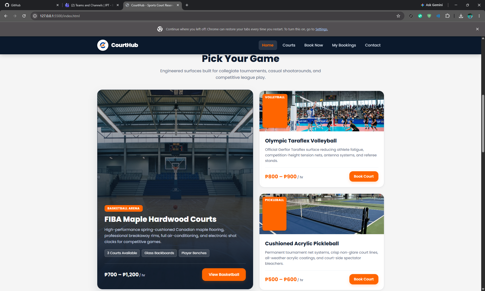
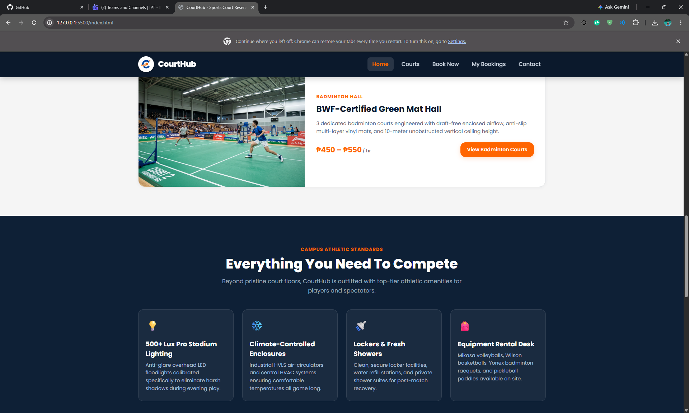
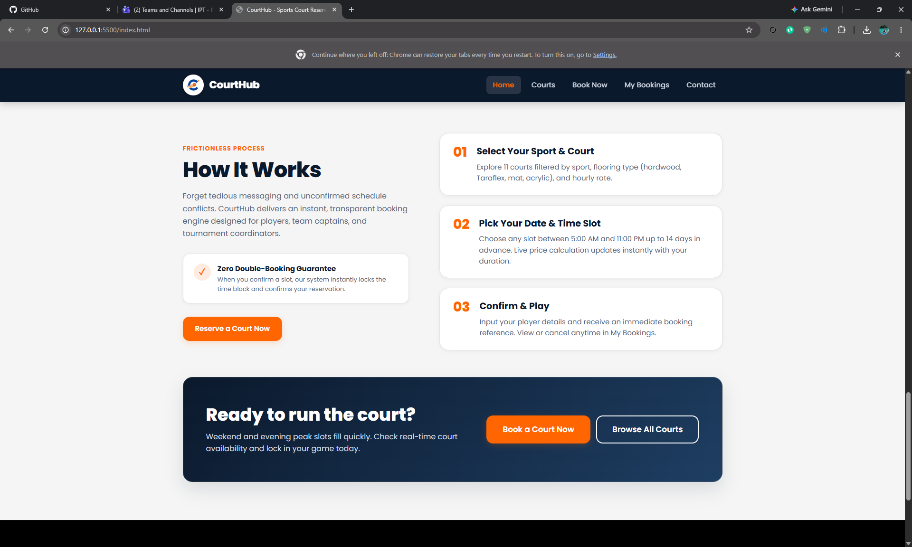
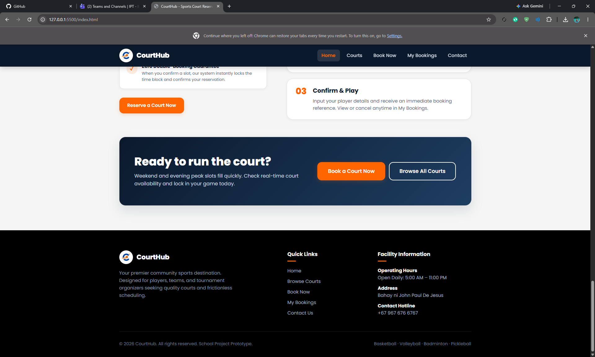

### Courts
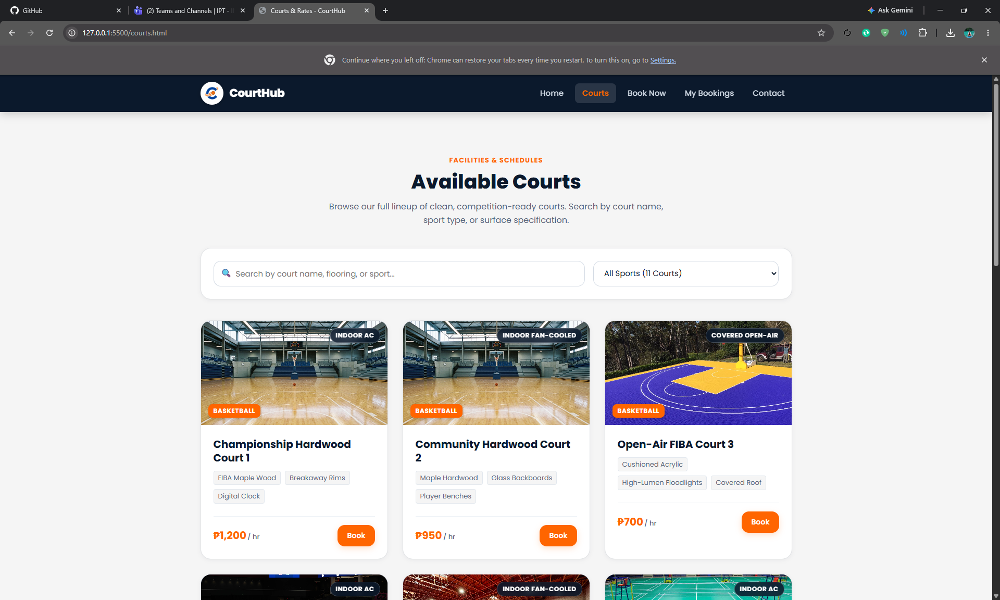
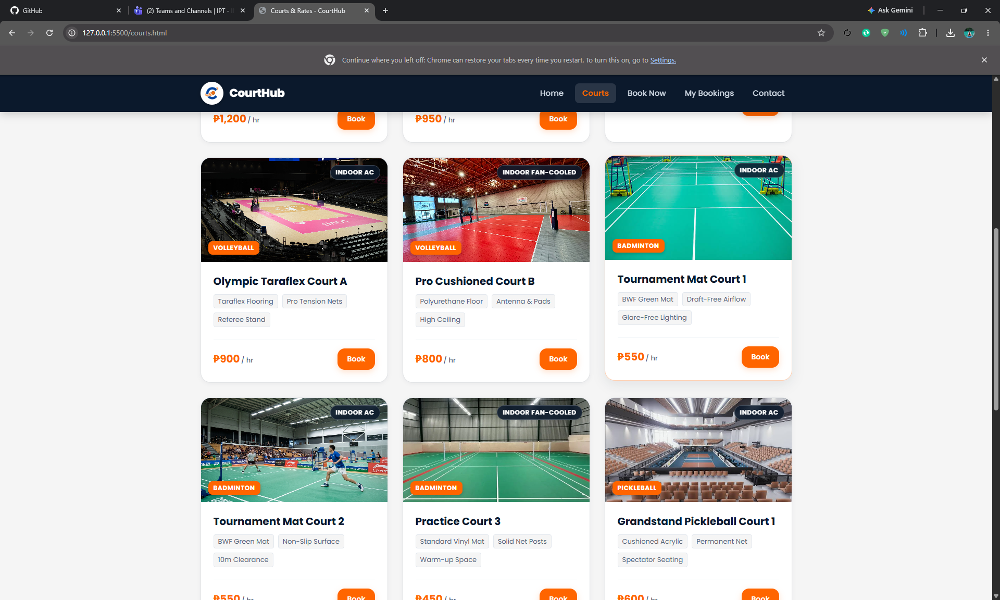
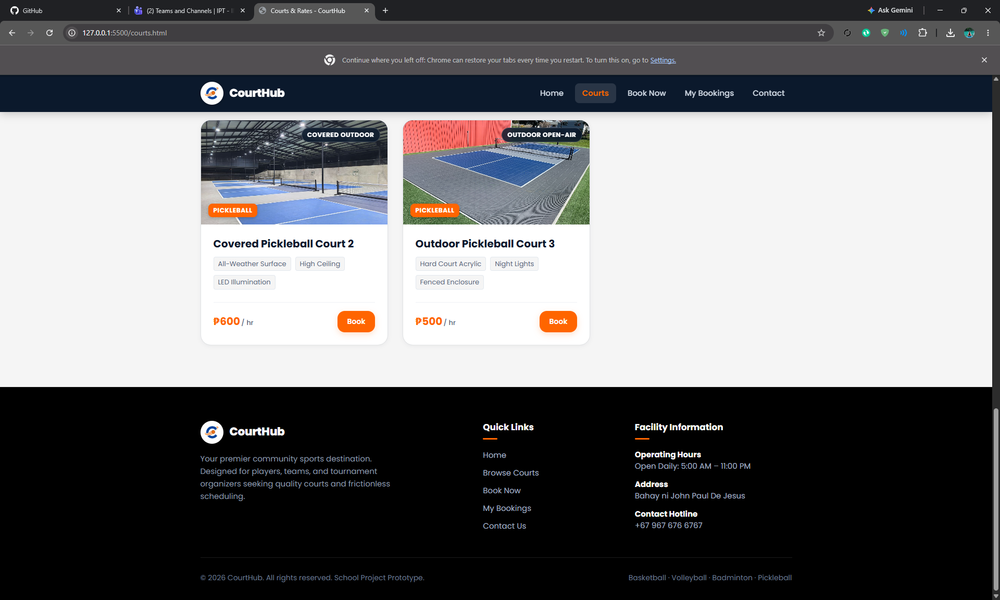

### Book Now
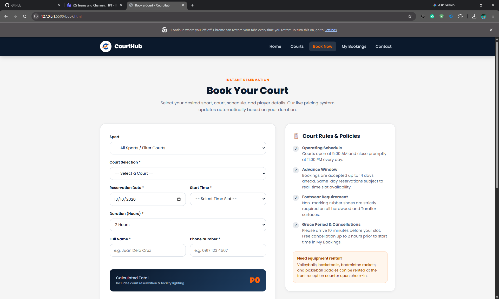
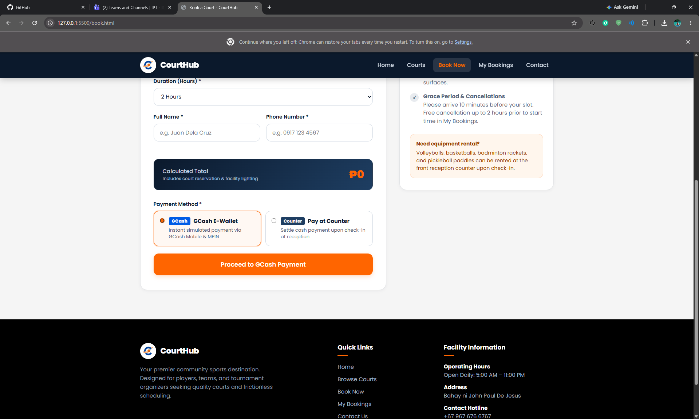

### My Bookings
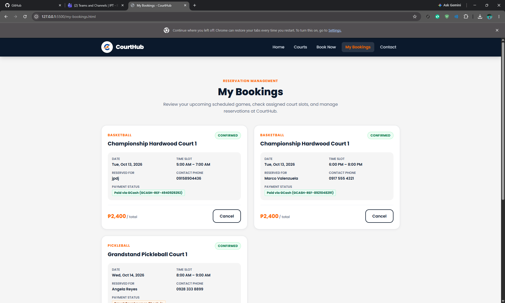

### Contact
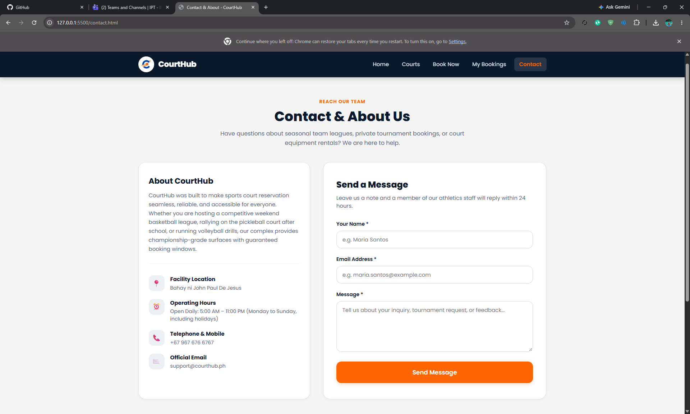
